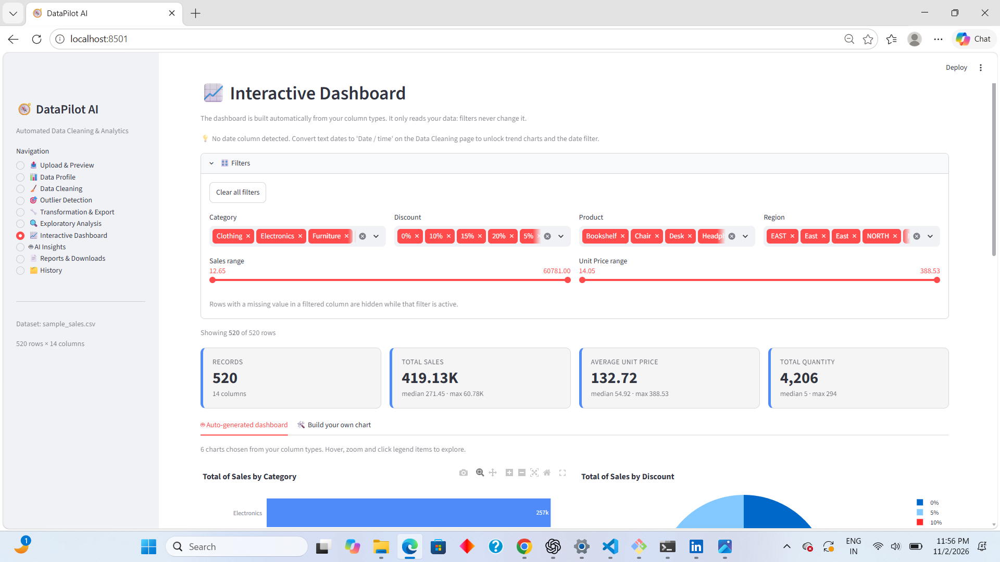
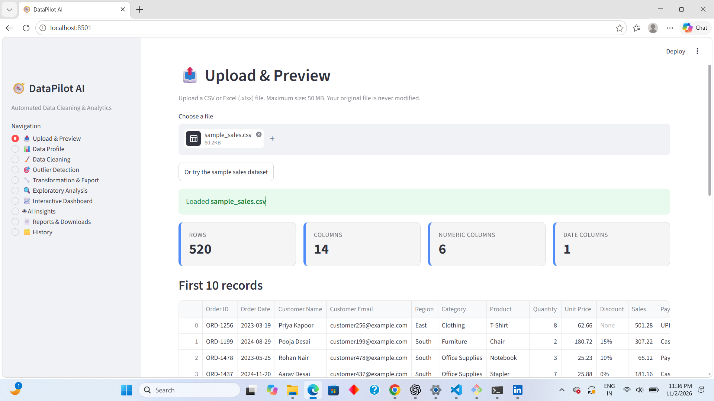
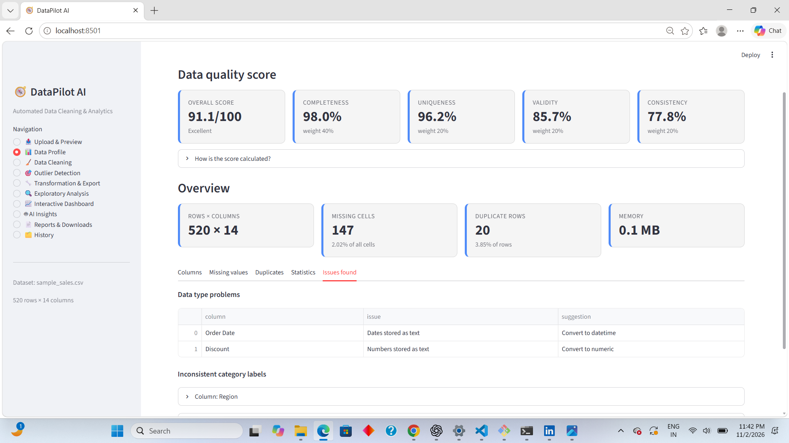
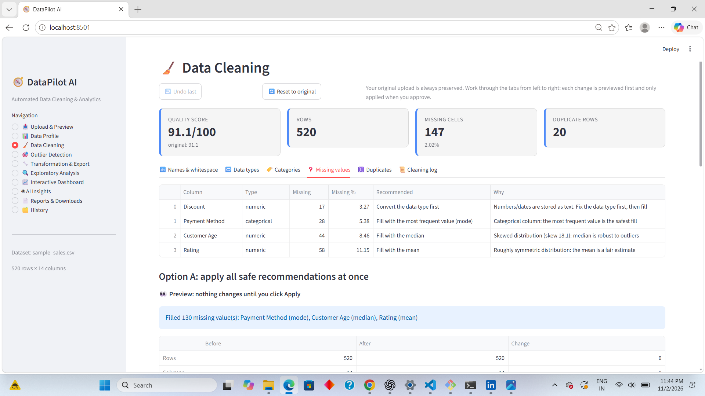
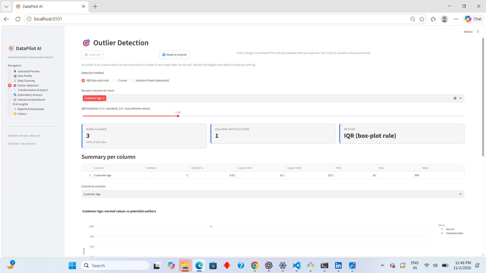
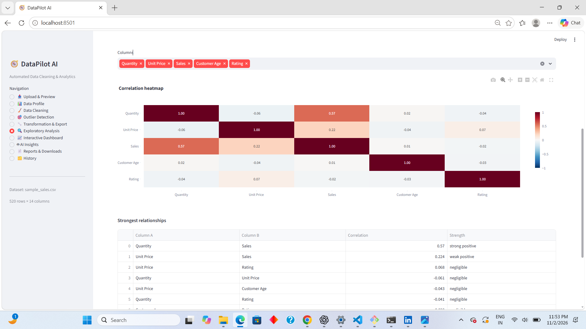
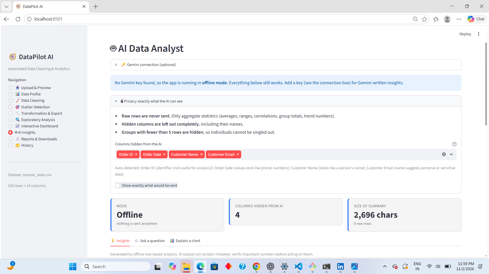
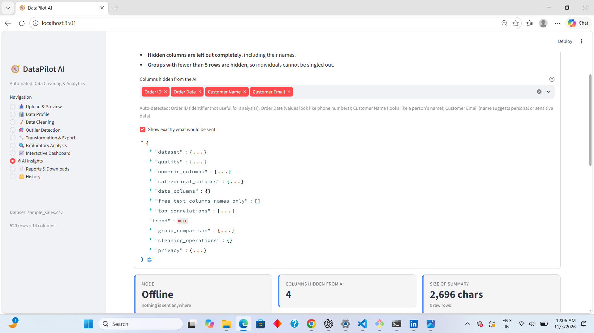
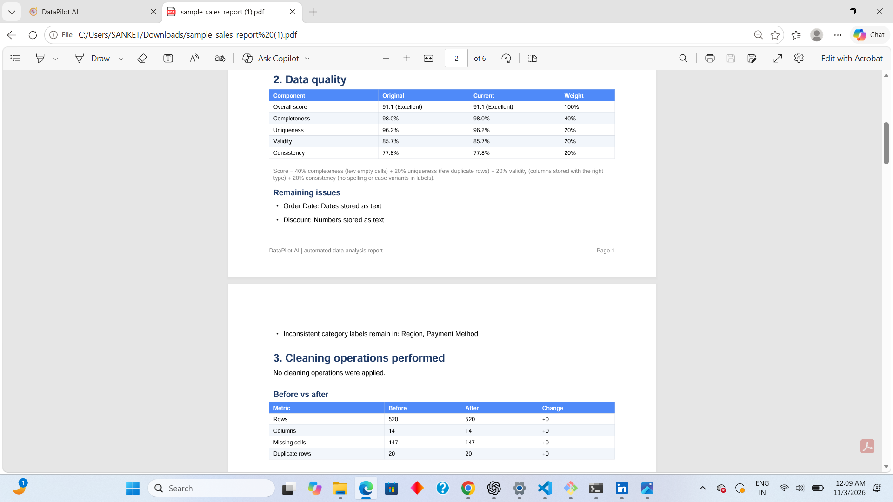
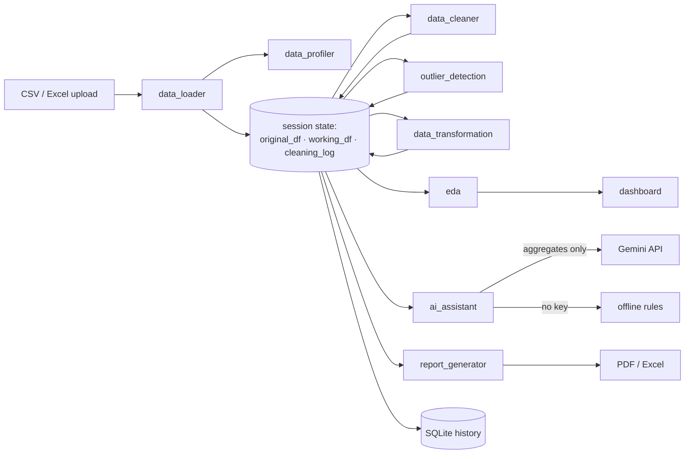

# 🧭 DataPilot AI

**Automated data cleaning and analytics platform.** Upload a messy CSV or Excel file and DataPilot profiles it, cleans it with your approval, finds outliers, builds interactive dashboards, writes AI-assisted insights, and exports a PDF and Excel report.

Built with Python, Pandas, Streamlit, Plotly, Scikit-learn and Google Gemini, as a data analyst portfolio project.

> 🔗 **Live demo:** <add the Streamlit Cloud link after Phase 12>



## ✨ Features

| Area | What it does |
|---|---|
| **Upload** | CSV and Excel (with sheet choice). Tries several encodings, detects the separator, drops fully empty rows, and rejects oversized files with a clear message |
| **Profiling** | Row and column counts, missing %, duplicates, unique values, type detection (including numbers or dates stored as text), statistics, and a transparent **data quality score** |
| **Cleaning** | Recommended fixes for missing values, duplicates, whitespace, column names, data types and inconsistent labels (`North` / `north ` / `NORTH`). Every change is **previewed first, then applied only when you approve**. Includes undo, reset, and a cleaning log |
| **Outliers** | IQR, Z-score and Isolation Forest. Keep, remove, cap, or blank the flagged values |
| **Transformation** | Change types, rename or drop columns, filter rows, calculated columns (no code execution), date features |
| **EDA** | Descriptive statistics, correlations (Pearson and Spearman), distributions, missing-value patterns, categories, trends over time, group comparisons |
| **Dashboard** | Built automatically from column types, so it works on **any dataset**: KPI cards, bar, line, pie, histogram, scatter and heatmap charts, with category, numeric and date filters |
| **AI analyst** | Gemini-written insights, recommendations, Q&A and plain-language chart explanations, or an **offline mode** that needs no key |
| **Reports** | A PDF (overview, quality, cleaning steps, statistics, charts, insights) and a multi-sheet Excel report |
| **History** | Optional local SQLite log of cleaning sessions (metadata only, never your data) |

## 📸 Screenshots

| | |
|---|---|
|  |  |
|  |  |
|  |  |
|  |  |

## 🏗️ Architecture

The UI and the logic are kept separate. `app.py` only draws pages. Everything in `modules/` is plain, testable Python with no Streamlit code.



```text
DataPilot-AI/
├── app.py                     # Streamlit UI: sidebar navigation and 10 pages
├── modules/
│   ├── data_loader.py         # safe CSV/Excel reading, column type detection
│   ├── data_profiler.py       # profiling and the data quality score
│   ├── data_cleaner.py        # cleaning with preview, log and undo support
│   ├── outlier_detection.py   # IQR, Z-score, Isolation Forest
│   ├── data_transformation.py # transformations and formula-safe exports
│   ├── eda.py                 # statistics, correlations, trends, comparisons
│   ├── dashboard.py           # column roles, filters, KPIs, automatic charts
│   ├── ai_assistant.py        # privacy-safe summaries, Gemini, offline mode
│   ├── report_generator.py    # PDF and Excel reports
│   └── database.py            # SQLite session history
├── assets/style.css           # KPI card styling
├── sample_data/               # a deliberately messy sample dataset and its generator
├── tests/                     # pytest suite, including an end-to-end pipeline test
└── docs/screenshots/
```

## 🔒 Responsible design

- **Your original upload is never modified.** All work happens on a copy, and *Reset* restores it.
- **Nothing destructive happens without approval.** Dropping rows, columns, duplicates or outliers needs a preview and a confirmation tick.
- **AI sees aggregates, never rows.** Gemini receives column statistics, correlations and group totals. Sensitive-looking columns (email, phone, names, IDs) are removed entirely, including their names. Groups with fewer than 5 rows are hidden. The app can show you the exact payload before anything is sent.
- **Works offline.** With no API key, insights come from rule-based logic on the same summary.
- **No secrets in code.** The API key is read from environment variables (`.env`, git-ignored) or Streamlit secrets.
- **Safe exports.** Text that looks like a spreadsheet formula (`=...`) is neutralized in CSV and Excel downloads.
- **Parameterized SQL.** History queries use placeholders, so user text cannot alter a query.

## 🚀 Quick start (Windows)

You need **Python 3.11 or 3.12** and **Git**.

```powershell
git clone https://github.com/sanketm4151/DataPilot-AI.git
cd DataPilot-AI
python -m venv venv
.\venv\Scripts\Activate.ps1
pip install -r requirements.txt
python sample_data\generate_sample_data.py
Copy-Item .env.example .env
streamlit run app.py
```

Open http://localhost:8501 and click **"Or try the sample sales dataset"**.

On macOS or Linux, activate with `source venv/bin/activate` and copy the env file with `cp .env.example .env`.

## ⚙️ Configuration

Edit `.env` (it is git-ignored):

| Variable | Purpose |
|---|---|
| `GEMINI_API_KEY` | Optional. Free key from [Google AI Studio](https://aistudio.google.com/). Without it the app runs in offline mode |
| `GEMINI_MODEL` | Optional. Overrides the built-in list of Gemini model names, which change over time |
| `DATAPILOT_ENABLE_HISTORY` | `1` keeps a local SQLite history of cleaning sessions. Off by default |
| `DATAPILOT_DEBUG` | `1` shows technical error details in the app (development only) |

On Streamlit Community Cloud, put `GEMINI_API_KEY` in the app's **Secrets** instead.

## 🧭 Suggested demo walkthrough

1. **Upload** the sample data and check the detected types (`Order Date` is text, `Discount` is `"10%"`).
2. **Profile** it: note the quality score and the issues found.
3. **Clean**: standardize names, convert types, fix categories, apply the recommended missing-value fills, and remove duplicates, reviewing each preview. Watch the score rise.
4. **Outliers**: find the impossible ages (up to 999) and cap them.
5. **Dashboard**: filter by region and date, then build a custom chart.
6. **AI Insights**: open the privacy panel, then generate insights and explain a chart.
7. **Reports**: generate and download the PDF and Excel reports.

## 🧪 Testing

```powershell
pytest
```

The suite covers each module plus an end-to-end test that loads the sample file, cleans it, handles outliers, builds both reports, and saves a history session. Gemini calls are faked in tests, so no network or key is needed.

## ⚠️ Limitations

- Built for datasets that fit in memory: up to 50 MB and 1,000,000 rows.
- Free hosting has limited memory, so very large files should be sampled first.
- The PDF uses a built-in font, so non-Latin characters (for example Hindi) print as `?`.
- Gemini free-tier limits are low and model names change, so the app has a fallback list and a model checker.
- Insights are generated from summary statistics and can be wrong. Verify important numbers.
- Correlation shown in charts does not prove causation.
- Missing-value recommendations are rules of thumb, not a substitute for domain knowledge.

## 🗺️ Possible next steps

Time-series forecasting, SQL database connectors, saved cleaning "recipes" you can replay on new files, and multi-file joins.

## 📄 License

MIT. See [LICENSE](LICENSE).

## 👤 Author

**Sanket Mane** · https://www.linkedin.com/in/sanket-mane-2194a3310/ · sanketm4151@gmail.com